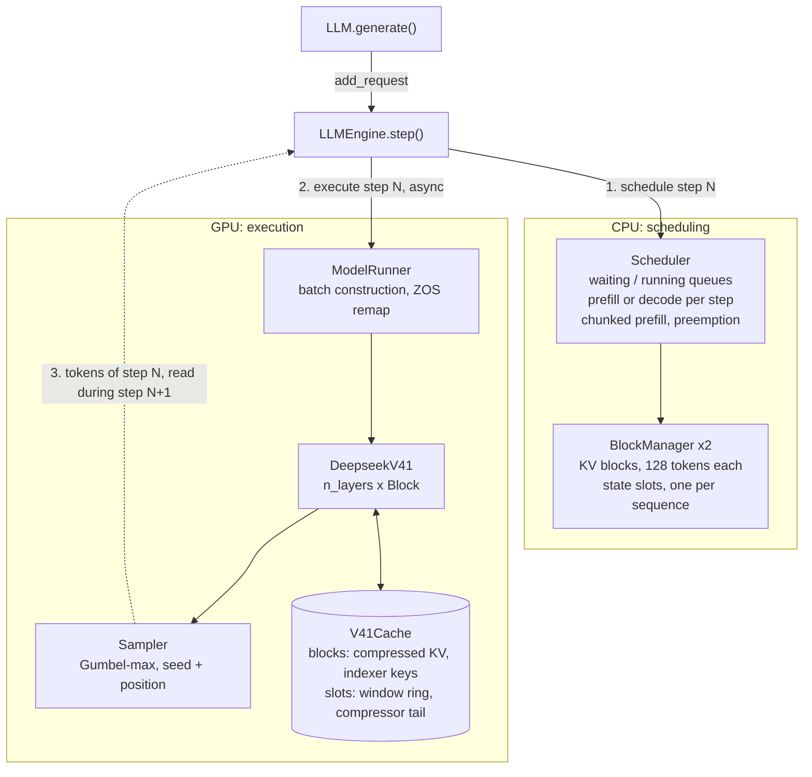
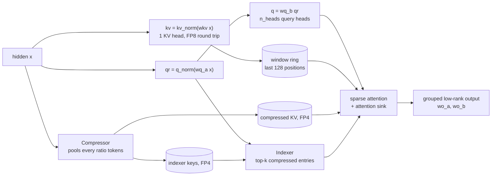

<h1 align="center">mini-DeepInfer</h1>

<p align="center">
  <a href="https://github.com/algebra-MCX/mini-DeepInfer/actions/workflows/ci.yml"></a>  <br>
  <a href="README.md">简体中文</a> · English
</p>

<p align="center">
  
</p>

> A DeepSeek-V4.1 runtime you can read: follow a request from the queue to its next sampled token.

**Read [DeepInfer](https://github.com/deepseek-ai/DeepInfer) in ~2,000 lines of PyTorch.** DeepInfer serves
DeepSeek-V4.1-Flash on dozens of GPUs with a C++ scheduler, EP/DP/CP parallelism and custom kernels; it is hard to
read and needs SM100 hardware. mini-DeepInfer keeps the engine design that makes it distinctive and drops the scale:
the full V4.1 architecture runs on a single GPU, the real V4.1-Flash runs on 4 B200s, and every step of a request
can be followed and changed.

## Quick start

```bash
git clone https://github.com/algebra-MCX/mini-DeepInfer.git
cd mini-DeepInfer
uv run examples/offline_inference.py
```

- **Environment**: on first run `uv` builds `.venv` from `uv.lock` (PyTorch 2.14 + CUDA 13.0, NVIDIA driver ≥ 580) and reuses it afterwards.
- **No uv**: install it with `curl -LsSf https://astral.sh/uv/install.sh | sh`, or skip it: `pip install -e . && python examples/offline_inference.py`.
- **Model**: [`tiny-random/deepseek-v4.1-flash-1017`](https://huggingface.co/tiny-random/deepseek-v4.1-flash-1017) is downloaded
  automatically. It has 68M parameters and every V4.1 architectural feature, but its weights are random, so the generated text is meaningless.
- **Hardware**: any CUDA GPU with 8 GB of VRAM; without a GPU only the CPU tests run (see [Hardware](#hardware)).

## Key results

- **The real DeepSeek-V4.1-Flash on 4 × B200, benchmarked the way DeepInfer benchmarks itself.** EP4 × DP4, 131k
  context; request counts, warm-up and measurement windows and metrics match the official `run_sweep.sh prefill`,
  and the plot comes straight out of the official `plot_pareto.py`. The parallel layer is ~40 lines
  ([`parallel.py`](minideepinfer/models/deepseek_v41/parallel.py)). [→ Performance](#performance)
- **Checked token by token against DeepSeek's official reference implementation.** Quantization and candidate
  selection match the official TileLang kernels bit for bit; the whole engine stays within 0.05 of the official
  `inference/model.py` logits in every scheduling mode: batching, ZOS, chunked prefill and preemption.
  [→ Correctness](#correctness)
- **The full V4.1 architecture**: sliding window + compressed KV, the two-level sparse indexer, hyper-connections,
  Engram n-gram memory, MoE, and the FP8 / FP4 round trips of the attention state; weights stay in the checkpoint's
  FP8 / FP4 format.
- **DeepInfer's engine design**: paged KV blocks + per-sequence state slots, separate prefill / decode steps
  (chunked prefill, preemption), zero-overhead scheduling (ZOS), deterministic sampling independent of batch
  composition, request cancellation and stop tokens.

## Performance

### Real DeepSeek-V4.1-Flash, single-node 4 × B200 prefill

Paired run on 2026-10-22 (with the three optimizations of reports A / B1 / C1): the same four GPUs, checkpoint and input tokens, EP4 / DP4 / CP1,
131,072-token context with 126,976 cached tokens, and 4,096 uncached input tokens per step per rank.
The window contains 10 complete steady-state steps.

| Engine | Input throughput (tok/s/GPU) | Mean step (ms) |
| --- | ---: | ---: |
| mini-DeepInfer (current) | **4,315.9** | 949.0 |
| Official DeepInfer + single-node NVLink adapter | **36,170.9** | 113.2 |

mini now reaches **11.9%** of this official configuration (an 8.4× gap). This is one paired run, not a three-run median or a
result with every optimization enabled. mini uses the current validated runtime, including grouped GEMMs, quantization, HC, RMSNorm and SwiGLU changes
plus three new optimizations: sparse attention on tensor cores, fused indexer scoring, and MoE combine over local
rows with in-place dequantization. Its optional
non-expert weight cache is disabled. Both engines use full replay and real routing, with no redundant experts,
speculation or decode CUDA graphs. Only prefill is measured; KV memory budgets are not forced to match.

**Optimizations and the remaining gap:** this result includes sparse attention on tensor cores
([report A](docs/perf-reports/A-tensor-core-sparse-attention.md)), fused indexer scoring
([report B1](docs/perf-reports/B1-fused-index-scores.md)) and MoE combine over local rows
([report C1](docs/perf-reports/C1-moe-combine.md)). The two largest items now are attention (about 432 ms, 182 ms
of it key concatenation) and MoE (410 ms). Per-stage numbers and run instructions are in the
[benchmark documentation](docs/benchmarks/README.md). Tiny-model single-GPU output throughput is a different
workload and metric and is not comparable to this table.

## Correctness

`tests/test_v41.py` runs DeepSeek's official reference implementation (`inference/model.py`, shipped with the
V4.1-Flash checkpoint) on the same weights.

| Check | Result |
| --- | --- |
| FP8 / FP4 fake quant vs. the official TileLang kernels | Bit-exact |
| Two-level candidate block selection | Bit-exact |
| Sinkhorn mixing and sparse attention vs. the official kernels | Match within bf16 tolerance |
| Engine end to end: 4 prompts (37–520 tokens) in one batch; ZOS on / off; chunked prefill 128 and 200; preemption | Logits within 0.05 of the reference at every step (~0.02 max observed); greedy tokens identical |

Tokens are compared up to the first step where the reference's own top-2 margin is within tolerance: random-weight
logits are flat, and past a near tie both sides compare noise.

```bash
pytest -m "not gpu"   # CPU only: scheduler, block manager
pytest                # full suite: needs a GPU + TileLang
```

The CPU CI runs only the CUDA-free checks; without a GPU the GPU tests show as skipped, which is not a pass.

## Architecture



Inside one V4.1 attention layer:



Only KV-source layers run a compressor and only index-source layers run an indexer; the layers in between read the
source's cache and reuse its top-k choice.

### How one step works

```
step N (enable_zos=True)
  CPU  schedule(N)        decisions use reservations only (cached / in-flight token counts)
  CPU  execute(N)         enqueue inputs, forward, sampling and copy-back; an in-flight input
                          token is gathered on the GPU from step N-1's output buffer (remap)
  CPU  process(N-1)       wait for step N-1, append tokens, finish and free sequences
  GPU  ... step N-1 ... | ... step N ...
```

V4.1 has two kinds of attention state, and the scheduler allocates both:

| State | Lives in | Written by |
| --- | --- | --- |
| Compressed KV, indexer keys | Paged KV blocks, 128 tokens each | KV-source layers, one entry per `ratio` tokens |
| Sliding-window ring, compressor tail | One state slot per sequence | Every layer / KV-source layers |

A preempted sequence releases both and is recomputed later; deterministic sampling reproduces the discarded token
exactly.

### Multiple GPUs: EP × DP

Every GPU runs its own scheduler and batch; attention and other dense layers are replicated. Routed experts are
split evenly across GPUs and the Engram tables by rows: these layers gather the tokens of all GPUs, apply only their
local shard, and reduce-scatter the results back. In a single process the communication is a no-op.

## Usage

```python
from minideepinfer import LLM, SamplingParams

llm = LLM("tiny-random/deepseek-v4.1-flash-1017", max_model_len=4096, kv_cache_memory_gb=2.0)
outputs = llm.generate(
    prompt_token_ids=[[100, 200, 300]],
    sampling_params=SamplingParams(temperature=0.7, top_p=0.9, max_tokens=16, seq_seed=42),
)
print(outputs[0].token_ids)
```

| Option | Meaning |
| --- | --- |
| `max_num_seqs`, `max_num_batched_tokens`, `max_model_len` | Batch limits |
| `chunked_prefill`, `prefill_attempt_interval` | Prefill scheduling (DeepInfer's default interval is 70) |
| `kv_cache_memory_gb` / `gpu_memory_utilization` | Cache budget: absolute, or a fraction of free memory |
| `weight_cache_memory_gb` | BF16 weight-cache budget for non-expert FP8 projections, in GiB; `0` disables it by default |
| `enable_zos` | Zero-overhead scheduling |
| `SamplingParams(seq_seed=...)` | Same input + same seed = same output, whatever the batch |
| `SamplingParams(stop_token_ids=...)` | Extra stop tokens; `LLMEngine.abort_request()` safely cancels an in-flight request |

With spare memory, `LLM(..., weight_cache_memory_gb=0.02)` avoids dequantizing weights on every projection.
The cache selects projections that fit the budget in module order, retains the original quantized weights,
and excludes routed experts and Engram tables. This setting adds 10.56 MiB on the tiny model. It is allocated
before the automatic KV budget is calculated, so it reduces the memory available for KV.
The benchmark option is `bench.py --weight-cache-gb 0.02`; gains depend on the model and workload, so caching stays disabled by default.

## Reading the code

| Question | Start here |
| --- | --- |
| How does a request move through the runtime? | [`docs/TECHNICAL.md`](docs/TECHNICAL.md), sections 2–5 |
| Where does V4.1's attention state live? | [`models/deepseek_v41/model.py`](minideepinfer/models/deepseek_v41/model.py) and section 3 of the technical notes |
| How do prefill, decode and preemption fit together? | [`engine/scheduler.py`](minideepinfer/engine/scheduler.py) |
| How is the cache budget computed? | [`worker/model_runner.py`](minideepinfer/worker/model_runner.py) |
| How is the model split across GPUs? | [`models/deepseek_v41/parallel.py`](minideepinfer/models/deepseek_v41/parallel.py), `MoE` and `EngramTable` |
| How is correctness checked? | [`tests/test_v41.py`](tests/test_v41.py) and [`tools/v41_reference.py`](tools/v41_reference.py) |

Where each part comes from in DeepInfer:

| mini-DeepInfer | DeepInfer |
| --- | --- |
| `engine/block_manager.py` | `csrc/engine/block_manager.hpp` |
| `engine/scheduler.py` | `csrc/engine/scheduler.hpp` (`_schedule_prefill`, `_schedule_decode`) |
| `engine/llm_engine.py` | `deepinfer/engine/llm_engine.py` (`step`) |
| `worker/model_runner.py` | `deepinfer/worker/worker.py` (`execute_model_step`), `csrc/engine/zos.cpp` |
| `layers/sampler.py` | `tilelang_ops/random_sampling.py` |
| `models/deepseek_v41/` | DeepSeek's `inference/model.py`, rewritten for paged, batched execution |
| `bench_prefill.py` | `examples/benchmark.py` + `examples/sweep/run_sweep.sh prefill` |
| `tools/v41_reference.py` | Golden logits from the reference implementation |

The [runtime design](docs/DEEPINFER_DESIGN.md) explains DeepInfer's core boundaries and the order this project
implements them in; the [technical notes](docs/TECHNICAL.md) walk through the current code.

## Hardware

| Use | Configuration | Notes |
| --- | --- | --- |
| CPU tests | 2 vCPUs, 4 GB RAM, 2 GB disk | Scheduler and block manager; the level the CI uses |
| Tiny checkpoint (quick start) | Any CUDA GPU with 8 GB VRAM (16 GB recommended), 16 GB RAM, 10 GB disk | `uv.lock` pins the CUDA 13.0 build of PyTorch, which needs NVIDIA driver ≥ 580 |
| Real DeepSeek-V4.1-Flash | Verified: 4 × NVIDIA B200, ~510 GB disk for the checkpoint | EP4 × DP4, ~137 GiB resident per GPU (weights + 12 GiB KV cache); does not fit on one GPU |

There is no CPU path for model execution. Check the license of a real checkpoint before using it.

## Roadmap

- [x] DeepSeek-V4.1 model and an official-reference regression suite
- [x] Paged blocks + state slots, chunked prefill, preemption, ZOS, deterministic sampling
- [x] Real V4.1-Flash on multiple GPUs with EP × DP, prefill benchmarked the official way
- [ ] Memory for long chunks (≥ 32,768 tokens per GPU): slice the indexer and attention output by query
- [ ] Decoder bounded replay (YoCo consumer layers replay only the last 140 tokens during prefill)
- [x] Grouped expert GEMMs and CUDA graphs for decode; remove forward host synchronizations so ZOS overlaps
- [ ] DSpark speculative decoding with confidence-scheduled verification
- [ ] Cost-model prefill chunking (DeepInfer Q&A)
- [ ] End-to-end batch-invariant inference
- [ ] Image input (V4.1 ships a ViT; the checkpoint already contains the vision weights)

## License

Apache 2.0. Parts of `models/deepseek_v41/` are adapted from DeepSeek's MIT-licensed reference implementation; see
[THIRD_PARTY_NOTICES](THIRD_PARTY_NOTICES).

## Acknowledgments

Design follows [DeepInfer](https://github.com/deepseek-ai/DeepInfer) and DeepSeek's V4.1 reference implementation;
the project layout is inspired by [nano-vllm](https://github.com/GeeeekExplorer/nano-vllm).
