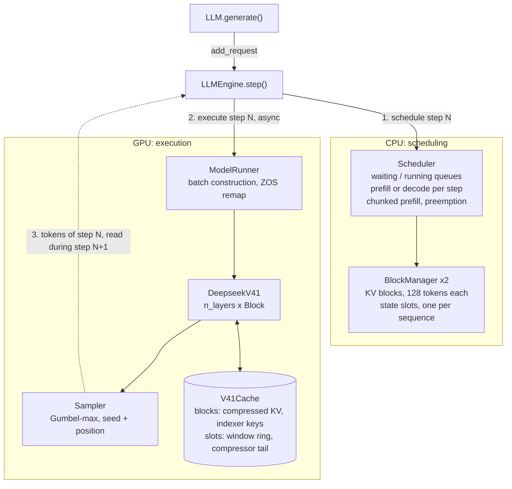
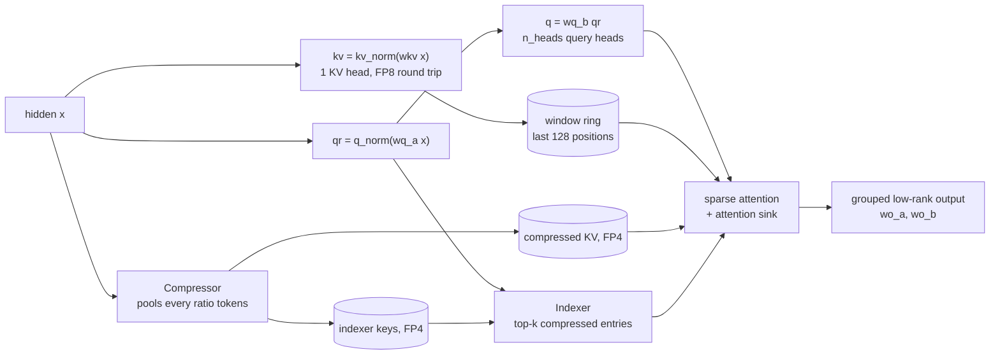

<h1 align="center">DeepInfer-Lab</h1>

<p align="center"><strong>从第一性原理重建推理系统</strong></p>

<p align="center">
  <a href="https://github.com/algebra-MCX/DeepInfer-Lab/actions/workflows/ci.yml"></a>  <br>
  <a href="README.md">English</a> · 简体中文
</p>

<p align="center">
  
</p>

**DeepInfer-Lab 是一个通过实验重走高性能推理系统设计过程的开放项目。**
我从简单、正确的运行时出发，逐步重建 [DeepInfer](https://github.com/deepseek-ai/DeepInfer) 的核心组件，
研究每项设计为什么会成为必要、解决了什么瓶颈，以及它怎样影响整个系统。

项目的目标是通过实验还原设计过程：解释每一次性能提升来自哪里、剩余差距在哪里，
并探索有没有不同、甚至更好的设计。

## 实验方法

每一项优化都应回答四个问题：

| 问题 | 实验需要解释什么 |
| --- | --- |
| **Why：为什么？** | 改动针对的是计算、内存、通信还是调度瓶颈？ |
| **How：怎么做？** | 算法、数据布局、kernel 或运行时发生了什么变化，为什么预期有效？ |
| **Performance：效果怎样？** | kernel 耗时、端到端吞吐、延迟和显存占用分别怎样变化？ |
| **Trade-offs：代价是什么？** | 哪些负载和硬件条件下有效，哪些情况下变差，需要付出什么代价？ |

每轮实验先建立正确基线、抓取 profile，再验证一个具体的设计假设。改动之后检查正确性，
同时测量 kernel 与端到端表现，再次 profile，找到下一个瓶颈。
**更快的 kernel 可能把瓶颈转移到别处。** 因此，Attention、GEMM、通信、状态管理和运行时调度，
需要放在真实运行的推理引擎中一起研究。

实验记录本身就是项目的一部分：问题动机、实现选择、正确性检查、benchmark 配置、profile、
实测结果，以及没有成功的尝试。你可以通过 [Issues](https://github.com/algebra-MCX/DeepInfer-Lab/issues)、
[性能报告](docs/perf-reports/)和 [benchmark 数据](docs/benchmarks/)复现、验证和质疑结论。
后续实验也会沿用这一方法，公开负面结果和仍待回答的问题。

## 当前研究范围

- **模型：** DeepSeek-V4.1-Flash。运行时包含完整的 V4.1 架构；tiny 随机权重 checkpoint 用于较小规模的开发与正确性检查。
- **测量重点：** 在 **4 × NVIDIA B200** 上运行真实模型的 prefill。整个 prefill 研究阶段固定这套 GPU 配置，
  与官方 benchmark 的 GPU 配置一致，研究算法、kernel 和系统设计带来的提升。每组结果都会列明负载和测量口径。
- **实现方式：** 保持运行时可读、可改，每个步骤都能检查和测量。代码随实验需要演进，研究围绕设计问题与实测影响展开。

## 快速开始

```bash
git clone https://github.com/algebra-MCX/DeepInfer-Lab.git
cd DeepInfer-Lab
uv run examples/offline_inference.py
```

- **环境**：首次运行时 `uv` 按 `uv.lock` 建好 `.venv`（PyTorch 2.14 + CUDA 13.0，需 NVIDIA 驱动 ≥ 580），之后直接复用。
- **没有 uv**：先 `curl -LsSf https://astral.sh/uv/install.sh | sh`；或者不用 uv，`pip install -e . && python examples/offline_inference.py`。
- **模型**：默认自动下载 [`tiny-random/deepseek-v4.1-flash-1017`](https://huggingface.co/tiny-random/deepseek-v4.1-flash-1017)，
  6800 万参数。架构特性和 V4.1 完全一致，但权重是随机的，生成的文本没有意义。
- **硬件**：任意一张 8 GB 显存的 CUDA GPU；没有 GPU 只能跑 CPU 测试，见[硬件要求](#硬件要求)。

## 核心成果

- **固定硬件下可追踪的优化过程：** 在已有记录的 4 × B200 优化轮次中，prefill 吞吐从 **1,084.8 提升到
  4,315.9 tok/s/GPU（3.98 倍）**。这是相对本项目自身基线的提升；与官方 DeepInfer 的对比见下文。
  [报告 A](docs/perf-reports/A-tensor-core-sparse-attention.md)、
  [报告 B1](docs/perf-reports/B1-fused-index-scores.md)和
  [报告 C1](docs/perf-reports/C1-moe-combine.md)记录了各轮设计选择，以及瓶颈如何随优化转移。
- **在 4 × B200 上跑真实的 DeepSeek-V4.1-Flash，并按 DeepInfer 官方口径测出性能。** EP4 × DP4，131k 上下文，
  请求数、热身和测量窗口、指标定义都与官方 `run_sweep.sh prefill` 一致，结果直接用官方 `plot_pareto.py` 出图。
  并行层只有约 40 行（[`parallel.py`](deepinfer_lab/models/deepseek_v41/parallel.py)）。[→ 性能](#性能)
- **逐 token 对照 DeepSeek 官方参考实现。** 量化、候选块筛选与官方 TileLang kernel 逐位一致；整个引擎在 batch、
  ZOS、chunked prefill、抢占等所有调度模式下，logits 与官方 `inference/model.py` 的差距都小于 0.05。[→ 正确性](#正确性)
- **完整的 V4.1 架构**：滑窗 + 压缩 KV、两级稀疏 indexer、hyper-connections、Engram n-gram 记忆、MoE，
  以及注意力状态的 FP8 / FP4 量化往返；权重保持 checkpoint 的 FP8 / FP4 格式。
- **DeepInfer 的引擎设计**：分页 KV block + 每序列 state slot、prefill / decode 分步调度（chunked prefill、抢占）、
  零开销调度（ZOS）、与 batch 组成无关的确定性采样、请求取消与 stop token。

## 性能

### 真实 DeepSeek-V4.1-Flash，单机 4 × B200，prefill 实测

2026-10-22 配对结果（含报告 A / B1 / C1 的三项优化）：相同四张 GPU、相同 checkpoint 和输入，EP4 / DP4 / CP1，131,072-token
上下文，其中 126,976 token 已缓存；每步每 rank 处理 4,096 个非缓存输入 token，统计 10 个完整稳态步。

| 引擎 | 输入吞吐（tok/s/GPU） | 平均每步（ms） |
| --- | ---: | ---: |
| DeepInfer-Lab（当前） | **4,315.9** | 949.0 |
| 官方 DeepInfer + 单节点 NVLink 适配 | **36,170.9** | 113.2 |

DeepInfer-Lab 当前达到本次官方配置的 **11.9%**（差距 8.4 倍）。这是单轮结果，不是三轮中位数，也不是全部优化开启后的性能上限。
DeepInfer-Lab 使用已验证的当前运行时代码，包含 grouped GEMM、量化、HC、RMSNorm、SwiGLU，以及三项新优化：
tensor core 稀疏注意力、融合 indexer 打分、MoE 只合并本地行并原地反量化；可选非专家权重缓存未开启。双方均 full replay、真实路由、无冗余专家、无
投机解码，均未启用 decode CUDA Graph；本轮只测 prefill，KV 显存预算未强制相等。

**优化与剩余差距：** 本结果包含稀疏注意力改用 tensor core
（[报告 A](docs/perf-reports/A-tensor-core-sparse-attention.md)）、融合 indexer 打分
（[报告 B1](docs/perf-reports/B1-fused-index-scores.md)）、MoE 只合并本地行
（[报告 C1](docs/perf-reports/C1-moe-combine.md)）三项优化。现在最大的两项是注意力（约 432 ms，
其中 182 ms 是拼接 key）和 MoE（410 ms）。分环节数据与运行方式见 [benchmark 文档](docs/benchmarks/README.md)。
tiny 模型的单卡生成吞吐不能与这组真实大模型的输入吞吐直接比较。

## 正确性

`tests/test_v41.py` 在相同权重上运行 DeepSeek 官方参考实现（`inference/model.py`，随 V4.1-Flash checkpoint 发布）进行对照。

| 检查项 | 结果 |
| --- | --- |
| FP8 / FP4 fake quant 对比官方 TileLang kernel | 逐位一致 |
| 两级候选块筛选 | 逐位一致 |
| Sinkhorn 混合、稀疏注意力对比官方 kernel | bf16 误差范围内一致 |
| 引擎端到端：4 个 prompt（37–520 token）同批；ZOS 开 / 关；chunked prefill 128 和 200；抢占 | 每一步 logits 与官方差距小于 0.05（实测最大约 0.02）；greedy token 一致 |

token 比较到官方自身 top-2 差距小于容差的那一步为止：随机权重的 logits 很平，近似平局之后两边比较的只是噪声。

```bash
pytest -m "not gpu"   # 仅 CPU：调度器、block manager
pytest                # 完整测试：需要 GPU + TileLang
```

CPU CI 只跑不依赖 CUDA 的检查；GPU 测试在没有 GPU 时显示为 skipped，不代表通过。

## 架构



V4.1 单个注意力层内部：



只有 KV 源层运行压缩器，只有 index 源层运行 indexer；中间的层读取源层的缓存，并复用它的 top-k 选择。

### 一个 step 的执行过程

```
第 N 步（enable_zos=True）
  CPU  schedule(N)        只依据预定状态决策（已缓存 / 在途 token 数）
  CPU  execute(N)         异步提交输入、forward、采样和回拷；仍在 GPU 上的在途 token
                          从第 N-1 步的输出缓冲中读取（remap）
  CPU  process(N-1)       等待第 N-1 步完成，追加 token，结束并释放序列
  GPU  ... 第 N-1 步 ... | ... 第 N 步 ...
```

V4.1 有两类注意力状态，调度器同时分配两者：

| 状态 | 存放位置 | 写入者 |
| --- | --- | --- |
| 压缩 KV、indexer 的 key | 分页 KV block，每块 128 个 token | KV 源层，每 `ratio` 个 token 一项 |
| 滑窗环形缓冲、压缩器尾部 | 每条序列一个 state slot | 每一层 / KV 源层 |

被抢占的序列释放两者，之后重新计算；确定性采样保证重算出的 token 与丢弃的完全相同。

### 多卡：EP × DP

每张卡跑自己的调度器和 batch；注意力等稠密层每卡复制一份。路由专家按卡均分，Engram 表按行切分：这些层先汇总
所有卡的 token，只用本卡的那一份计算，再把结果 reduce-scatter 回各卡。单进程运行时这些通信都是空操作。

## 用法

```python
from deepinfer_lab import LLM, SamplingParams

llm = LLM("tiny-random/deepseek-v4.1-flash-1017", max_model_len=4096, kv_cache_memory_gb=2.0)
outputs = llm.generate(
    prompt_token_ids=[[100, 200, 300]],
    sampling_params=SamplingParams(temperature=0.7, top_p=0.9, max_tokens=16, seq_seed=42),
)
print(outputs[0].token_ids)
```

| 参数 | 含义 |
| --- | --- |
| `max_num_seqs`、`max_num_batched_tokens`、`max_model_len` | batch 上限 |
| `chunked_prefill`、`prefill_attempt_interval` | prefill 调度（DeepInfer 的默认间隔为 70） |
| `kv_cache_memory_gb` / `gpu_memory_utilization` | 缓存预算：绝对值，或空闲显存的比例 |
| `weight_cache_memory_gb` | 非专家 FP8 投影的 BF16 权重缓存上限，单位 GiB；默认 `0` 关闭 |
| `enable_zos` | 零开销调度 |
| `SamplingParams(seq_seed=...)` | 相同输入 + 相同 seed = 相同输出，与 batch 组成无关 |
| `SamplingParams(stop_token_ids=...)` | 额外的停止 token 集合；`LLMEngine.abort_request()` 可安全取消在途请求 |

显存充足时可设置 `LLM(..., weight_cache_memory_gb=0.02)`，避免每次投影都反量化权重。
缓存按模块顺序选取能放入预算的投影，保留原始量化权重，不包含路由专家和 Engram 表；
tiny 模型该配置实际增加 10.56 MiB。缓存先于自动 KV 预算分配，因此会占用部分原本可用于 KV 的显存。
基准对应参数为 `bench.py --weight-cache-gb 0.02`；收益与模型和负载有关，默认保持关闭。

## 读代码

| 想了解的问题 | 从哪里开始 |
| --- | --- |
| 一个请求如何穿过整个运行时？ | [`docs/TECHNICAL.md`](docs/TECHNICAL.md) 第 2–5 节 |
| V4.1 的注意力状态存在哪里？ | [`models/deepseek_v41/model.py`](deepinfer_lab/models/deepseek_v41/model.py) 与技术说明第 3 节 |
| prefill、decode 和抢占如何配合？ | [`engine/scheduler.py`](deepinfer_lab/engine/scheduler.py) |
| 缓存预算怎样计算？ | [`worker/model_runner.py`](deepinfer_lab/worker/model_runner.py) |
| 多卡怎样切分？ | [`models/deepseek_v41/parallel.py`](deepinfer_lab/models/deepseek_v41/parallel.py) 与 `MoE`、`EngramTable` |
| 正确性怎样验证？ | [`tests/test_v41.py`](tests/test_v41.py) 与 [`tools/v41_reference.py`](tools/v41_reference.py) |

与 DeepInfer 源码的对应关系：

| DeepInfer-Lab | DeepInfer 对应位置 |
| --- | --- |
| `engine/block_manager.py` | `csrc/engine/block_manager.hpp` |
| `engine/scheduler.py` | `csrc/engine/scheduler.hpp`（`_schedule_prefill`、`_schedule_decode`） |
| `engine/llm_engine.py` | `deepinfer/engine/llm_engine.py`（`step`） |
| `worker/model_runner.py` | `deepinfer/worker/worker.py`（`execute_model_step`）、`csrc/engine/zos.cpp` |
| `layers/sampler.py` | `tilelang_ops/random_sampling.py` |
| `models/deepseek_v41/` | DeepSeek 的 `inference/model.py`，改写为分页、批处理执行 |
| `bench_prefill.py` | `examples/benchmark.py` + `examples/sweep/run_sweep.sh prefill` |
| `tools/v41_reference.py` | 从官方参考实现生成基准 logits |

[运行时设计](docs/DEEPINFER_DESIGN.md) 解释官方 DeepInfer 的核心边界与本项目的实现顺序，[技术说明](docs/TECHNICAL.md) 逐段对应当前代码。

## 硬件要求

| 用途 | 配置 | 说明 |
| --- | --- | --- |
| CPU 测试 | 2 vCPU、4 GB 内存、2 GB 磁盘 | 调度器与 block manager；CI 使用这个级别 |
| tiny checkpoint（快速开始） | 任意 CUDA GPU、8 GB 显存（建议 16 GB）、16 GB 内存、10 GB 磁盘 | `uv.lock` 锁定 CUDA 13.0 版 PyTorch，需要 NVIDIA 驱动 ≥ 580 |
| 真实 DeepSeek-V4.1-Flash | 已验证：4 × NVIDIA B200，checkpoint 约 510 GB 磁盘 | EP4 × DP4，每卡常驻约 137 GiB（权重 + 12 GiB KV cache）；单卡放不下 |

没有 CPU 上的模型执行路径。使用真实 checkpoint 前请先确认它的许可证。

## 路线图

### 核心 kernel 研究计划

我计划**从零重建 FlashMLA、DeepGEMM 和 DeepEP**，先写出简单、正确的研究实现，
再逐个接入运行时。每个阶段都会先 profile，再逐步优化，同时测量 kernel 级和端到端表现。

- [ ] **FlashMLA：** 研究注意力的数据搬运、KV 访问和 tile 划分，量化它们对完整注意力路径的影响。
- [ ] **DeepGEMM：** 研究低精度 GEMM、专家分组计算与数据准备，同时评估数值和显存代价。
- [ ] **DeepEP：** 在 MoE 执行路径中研究专家 dispatch/combine、通信，以及通信与计算的重叠。

以上是未来研究方向。已有 kernel 和通过验证的运行时能力见前文；
这些组件的重建会形成新的实验和对照结果。

### 运行时与模型里程碑

- [x] DeepSeek-V4.1 模型与官方实现对照测试套件
- [x] 分页 block + state slot、chunked prefill、抢占、ZOS、确定性采样
- [x] EP × DP 多卡运行真实 V4.1-Flash，按官方口径测 prefill
- [ ] 长 chunk（≥ 32,768 token / 卡）的显存：indexer 与注意力输出按 query 分块
- [ ] Decoder bounded replay（YoCo consumer 层 prefill 只重放末尾 140 token）
- [x] 专家分组 GEMM、decode 的 CUDA graph；去掉 forward 中的 host 同步，使 ZOS 重叠
- [ ] DSpark 投机解码，按置信度调度验证
- [ ] 代价模型的 prefill chunk 切分（DeepInfer Q&A）
- [ ] 端到端 batch-invariant 推理
- [ ] 图像输入（V4.1 自带 ViT，checkpoint 已包含视觉权重）

## 参与和技术讨论

欢迎反馈、设计讨论、profiling 分析、复现验证和代码贡献。我也希望组织非正式的技术学习交流，
一起研究架构、kernel、测量结果和设计取舍。
你可以从 [Issues](https://github.com/algebra-MCX/DeepInfer-Lab/issues) 开始，或通过
[我的 GitHub 主页](https://github.com/algebra-MCX)联系我。

我也参与 vLLM 的 Model Runner V2 开发（[#63372](https://github.com/vllm-project/vllm/pull/63372)、
[#63476](https://github.com/vllm-project/vllm/pull/63476)），并在
[小红书](https://www.xiaohongshu.com/user/profile/6ad229240000000005006800)分享「vLLM 晋升挑战」的进展。

### 未来合作与 decode 研究

如果有足够的社区兴趣，我希望探索与 **Inferact 团队**合作，争取更多 GPU 节点，
理想情况下借用 **64 张 SM100 GPU 的集群**，进一步开展 decode 优化研究。
合作和集群资源都属于未来设想，项目当前是独立的教育与实验项目。
Prefill 研究会继续使用固定的 4 × B200 配置。

> **项目近况（2026-10-25）：** 这个项目会持续更新。近日身体有些不适，我先休息几天。为了保持本仓库提交历史的整洁，我已将大部分个人优化代码放到私有仓库中。项目仍会继续推进，短暂休息后会恢复公开仓库的更新。感谢大家的理解与支持。

## 许可

Apache 2.0。`models/deepseek_v41/` 的部分代码改写自 DeepSeek 的 MIT 协议参考实现，见 [THIRD_PARTY_NOTICES](THIRD_PARTY_NOTICES)。

## 致谢

设计参考 [DeepInfer](https://github.com/deepseek-ai/DeepInfer) 和 DeepSeek 的 V4.1 参考实现，项目结构受 [nano-vllm](https://github.com/GeeeekExplorer/nano-vllm) 启发。
