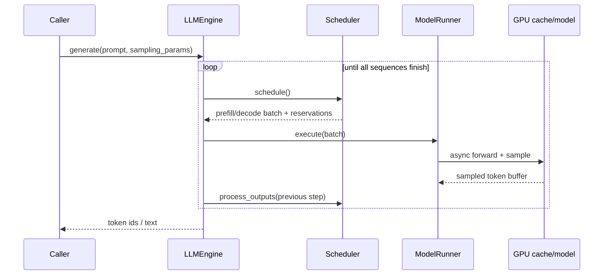
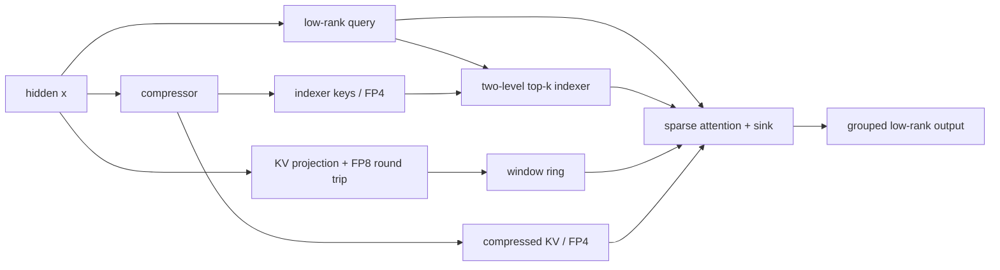

# DeepInfer-Lab 技术说明：从请求到 DeepSeek-V4.1

这份文档说明 DeepInfer-Lab 如何把一个请求变成可复现的 V4.1 推理步骤。它对应当前仓库代码，重点是可以读懂、可以验证和可以改动的实现边界；它不是对 DeepInfer 生产集群性能的承诺。先阅读 [DeepInfer 风格的运行时设计](DEEPINFER_DESIGN.md)，了解官方设计与本项目的映射、step 数据契约和后续实现顺序，再阅读下面的代码导览。

## 1. 范围与运行边界

DeepInfer-Lab 是单 GPU、纯 PyTorch 的教学型运行时，包含：

- DeepSeek-V4.1 的压缩 KV、滑动窗口、两级稀疏 indexer、hyper-connections、Engram 和 MoE；
- DeepInfer 风格的分页 KV block、每序列 state slot、连续批处理、chunked prefill、抢占和确定性采样；
- 与官方 V4.1 reference 的组件和端到端对照测试。

它没有复刻生产系统的 C++ 调度器、EP/DP/CP 通信、定制 CUDA/TileLang kernel 或 DSpark/MTP 服务路径。默认 checkpoint 是随机权重的小型模型，适合测试形状和执行语义，不能用来评价生成质量。

## 2. 一次请求的生命周期

入口在 `deepinfer_lab/entrypoints/llm.py`。`LLM.generate()` 为每个 prompt 创建 `Sequence`，交给 `LLMEngine`；每次 `step()` 都经历三个阶段：

1. `Scheduler.schedule()` 在 CPU 上决定本步是 prefill 还是 decode，并为序列预留 KV block 与 state slot；
2. `ModelRunner.execute()` 将 batch、block table、位置和采样参数异步送入 GPU；
3. `Scheduler.process_outputs()` 在结果可读后提交 token，处理 EOS/stop token/长度上限，并释放已完成或被抢占的状态。
   显式取消通过 `LLMEngine.abort_request()` 先排空在途 step，再让 scheduler 使 epoch 失效并回收两类缓存。

调度器不把 prefill 和 decode 混在同一步。prefill 可以按 `max_num_batched_tokens` 切块；decode 每条运行中的序列前进一个 token。当 block 不足时，较长输出优先被抢占，释放的序列回到 waiting 队列并在之后重算。



## 3. V4.1 的注意力状态

V4.1 同时维护两类状态，不能只用传统的 `[layer, batch, head, time]` KV cache 来理解：

| 状态 | 运行时位置 | 写入方式 | 释放方式 |
| --- | --- | --- | --- |
| 压缩 KV 与 indexer key | 分页 block，每块 `PAGE_TOKENS=128` 个 token | KV source layer 按 `compress_ratio` 写入 | 序列结束或抢占时释放 block |
| 滑动窗口与 compressor tail | 每个序列一个 state slot | 每层更新窗口；KV source layer 更新 tail | 与序列 block 一起释放 slot |

`V41Cache.allocate()` 按模型配置一次性分配这些张量。`BlockManager` 只管理 block 的所有权和引用计数；state slot 由第二个 `BlockManager` 管理，因此调度时必须同时满足两种资源的容量。

在一个注意力层中，hidden state 经过低秩 query、单 KV 头的量化往返、压缩器和 indexer：



只有配置为 KV source 的层写压缩缓存，只有 index source 的层计算 top-k；其余层通过 `kv_source_of()` 和 `index_source_of()` 复用最近的源层结果。这样既保留 V4.1 的层间复用语义，又让缓存布局能被连续 batch 访问。

## 4. 分页 block 与 state slot

每条 `Sequence` 保存自己的 `block_table`、`state_slot`、已缓存 token 数和在途 token 数。block 0 是保留的 padding block；真实 block 从 1 开始分配。释放时 block 进入 free list 尾部，引用计数归零后才可再次使用。

调度器的几个不变量是：

- `num_cached_tokens` 表示已经写入 KV/state 的位置；
- `num_inflight_tokens` 表示已经提交到 GPU 但 CPU 尚未处理的结果；
- decode 只在 `num_cached_tokens == sequence_length - 1` 时推进；
- 抢占会释放 block 和 slot，并增加 `epoch`，使旧的在途结果失效；
- 相同 `seq_seed` 和位置会产生相同的随机采样，因此重算可以复现被丢弃的 token。

## 5. Zero-overhead scheduling（ZOS）

开启 `enable_zos` 时，CPU 不必等待上一轮采样结果才开始安排下一轮。`ModelRunner` 会保留上一轮 GPU token buffer；如果下一轮 decode 所需 token 尚未回到 CPU，就通过 `remap` 在 GPU 上直接索引该 buffer。CPU 仍然依据预留计数做容量判断，GPU 则在同一 stream 上按依赖读取 token。

```text
step N:     schedule(N) -> enqueue forward/sample -------------------->
step N+1:   schedule(N+1) -> remap previous sampled buffer -> enqueue ->
CPU:        process(N-1) -------------------------------> commit token
```

当前 forward 仍有若干 host-visible 的 PyTorch 操作，因此 ZOS 的结构已经存在，但还没有达到生产实现的完全重叠。这个限制也是路线图中“去掉 forward host synchronization”的原因。

## 6. 采样与确定性

`layers/sampler.py` 使用 Gumbel-max 路径实现 temperature、top-k 和 top-p 采样。随机种子由序列 seed 与 token position 混合得到，而不是由 batch 行号决定。因此，同一输入、同一 `seq_seed` 在不同 batch 组成和抢占历史下仍应得到同一 token 序列。

这项确定性是抢占正确性的组成部分：抢占本身丢掉了缓存，需要重算前缀；如果采样依赖全局 RNG 状态，重算会改变后续 token，调度器就无法验证“释放后重放”等价。

## 7. 正确性证据

测试分三层：

| 层级 | 命令/文件 | 目的 |
| --- | --- | --- |
| CPU 资源 | `tests/test_block_manager.py`, `tests/test_scheduler.py` | 验证 free list、引用计数、chunked prefill、抢占和边界 |
| 采样 | `tests/test_sampler.py` | 验证 seed、温度、top-k/top-p 和 batch 独立性 |
| V4.1 对照 | `tests/test_v41.py` | 对比官方 reference 的量化、indexer、稀疏 attention 和端到端 logits |

运行完整检查：

```bash
cd DeepInfer-Lab
pytest tests/test_block_manager.py tests/test_scheduler.py tests/test_sampler.py
pytest
```

GPU 和官方 reference 测试需要可用的 CUDA 环境；没有 GPU 时应运行 CPU 子集，并把未执行的检查标为未验证，而不是把它们当成通过。

## 8. 从哪里开始改

| 目标 | 入口 |
| --- | --- |
| 改调度策略 | `deepinfer_lab/engine/scheduler.py` |
| 改 block/slot 生命周期 | `deepinfer_lab/engine/block_manager.py`、`sequence.py` |
| 改 ZOS batch 构造 | `deepinfer_lab/worker/model_runner.py` |
| 改 V4.1 attention / MoE | `deepinfer_lab/models/deepseek_v41/model.py` |
| 改低精度状态 | `deepinfer_lab/models/deepseek_v41/quant.py`、`weights.py` |
| 改可复现实验 | `tests/`、`tools/v41_reference.py` |

推荐的修改顺序是先写一个能暴露状态或调度差异的最小测试，再改实现，最后用 reference logits 和抢占/批组成变体回归。性能数字必须注明 GPU、checkpoint、batch、上下文长度、dtype 和是否包含 warm-up。

## 9. 已知边界与后续工作

当前实现优先保证“读得懂且对得上”：

- forward 主要使用 PyTorch，host synchronization 仍会限制 ZOS 重叠；
- MoE 还是逐专家路径，尚未实现 grouped GEMM 和 decode CUDA Graph；
- DSpark 投机解码、prefill 成本模型和端到端 batch-invariant 仍在路线图中；
- 随机权重 checkpoint 只能验证执行语义，不能证明 DeepSeek-V4.1 的任务质量或生产吞吐。

相关路线图、许可和第三方声明见 [README](../README.zh-CN.md) 与 [THIRD_PARTY_NOTICES](../THIRD_PARTY_NOTICES)。
